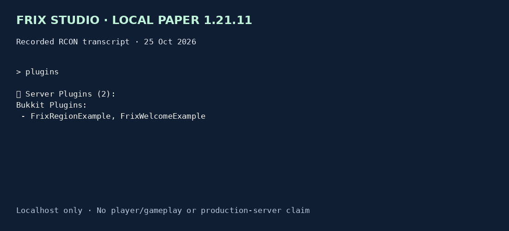

# Frix region example

MIT portfolio source, not a client reference. 5 local tests cover MockBukkit loading/permissions and region boundaries, dimension scope and invalid coordinates.

Built against Paper API 1.21.11 with JDK 21 and Gradle 9.8.2. Real localhost Paper 1.21.11 and 26.3 tests passed on 25 Oct 2026: both plugins loaded and operator reload commands completed over RCON. The tested main-class bytecode and resources match this repository build. This is runtime smoke evidence, not a player-session or production compatibility claim.



This 65 KB GIF renders actual RCON replies; it is not gameplay footage. Raw transcripts are included under `evidence/`. The studio matrix stopped both servers, verified closed ports and reset only generated test worlds.

```sh
gradle --no-daemon test jar
```

One configured X/Z region in one world. Private entry notice with a five-minute cooldown; no broadcast or external network. Operator-only `/frixregion reload`; invalid bounds disable notices.

No external credentials, webhook, player database or paid service. Tests use synthetic local players. Before client delivery: reproduce the agreed issue, test the agreed server versions, retain a backup and rollback, and obtain Reda’s review of the diff and real test evidence.
